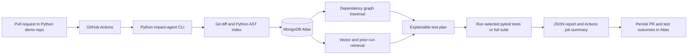

# PR Impact Agent architecture

## Goal and MVP boundary

The agent analyzes a pull request in a separate Python demo repository, selects likely regression tests, runs them, and explains the selection. It uses MongoDB Atlas for repository context, graph traversal, semantic search, and memory of earlier pull request outcomes. The core is a Python CLI invoked by GitHub Actions; the user additionally approved a local Streamlit dashboard.

The implementation is intentionally limited to one Python repository and pytest. Security checks and code-cleanup recommendations are follow-up work. See `PROBLEM.md` for the product goal and `REQUIREMENTS.md` for acceptance criteria and ticket ownership.

## Repositories and runtime flow

There are two repositories:

- **Agent repository:** this repository. It contains the Python package and CLI.
- **Demo repository:** a separate, team-controlled Python repository with sample application code, tests, and GitHub Actions workflows. Its workflow installs the agent from an immutable commit or release in the agent repository.



The default branch is indexed before PR analysis. A push to the demo repository's default branch refreshes its indexed snapshot; `workflow_dispatch` can run indexing or rehearse analysis manually. The PR workflow checks out enough Git history to compare the event's base and head SHAs. It only uses an index that matches the PR base SHA. If the snapshot does not match, analysis falls back to the full suite and reports that reason.

Use the normal `pull_request` event for the team-owned demo repository. Do not use `pull_request_target` to run code from a PR. The demo workflow stores `MONGODB_URI` as an Actions secret and uses a database user with only the needed access. The workflow installs the agent from a pinned commit so a run is reproducible. GitHub-hosted fork PRs do not receive ordinary repository secrets, so the hackathon demo uses branches in the team-owned repository.

## Components and interfaces

### Python CLI

Package the agent as an installable Python project with an `impact-agent` command.

```text
impact-agent index --repo <path> --repo-id <id> --commit <sha>
impact-agent analyze --repo <path> --repo-id <id> --base <sha> --head <sha> --output <json-path> --summary <markdown-path>
```

- `index` ensures the Atlas collections and `knowledge_vector` index exist, then scans the Python demo repository at the specified commit, extracts source and pytest test chunks, derives import and test relationships, and writes a versioned snapshot through the same database connection.
- `analyze` reads the base/head diff, looks up graph and semantic candidates, reads similar prior-run memories, runs the selected tests or the full suite, stores the outcome, and writes both a JSON report and a Markdown summary, including when tests fail.
- The report includes base and head SHAs, changed paths, chosen tests, selection reasons and evidence, test outcomes, elapsed time, whether fallback ran, and the fallback reason when present.
- The CLI exits successfully when the executed test command passes and with a nonzero status when it fails. This lets the Action publish the report and reflect the test result.

### Atlas collections

Use one database with two application collections:

- **`knowledge`:** Python source chunks, test chunks, and prior PR run summaries. Common fields are `repo_id`, `base_sha`, `kind` (`code`, `test`, or `pr_run`), `path`, `symbol`, and `search_text`. Code and test documents carry their source text and stable IDs. Run documents carry changed paths, selected test IDs, test outcomes, and a short searchable summary.
- **`edges`:** explicit dependency relationships. Each edge has `repo_id`, `base_sha`, `source_id`, `target_id`, and `kind` (`imports` or `tested_by`). Orient edges from a dependency to its dependent: a changed module is `source_id`, and an importing module or associated test is `target_id`.

Create a Vector Search `autoEmbed` index on `knowledge.search_text` with model `voyage-code-4`. Include filter fields for `repo_id`, `base_sha`, and `kind` so code, tests, and prior runs can be queried separately. Before the demo, verify the selected Atlas cluster supports the index, that the index is ready, and that an actual vector query returns results. Automated embedding model availability, billing, and index readiness are Atlas setup prerequisites.

### Test selection and fallback

1. Compute changed paths between the requested base and head commits.
2. Include changed pytest files directly.
3. Resolve changed Python modules to indexed node IDs and traverse `edges` with `$graphLookup`, selecting at most two hops and using one additional lookahead edge to detect when full-suite fallback is needed.
4. For each changed code chunk, run a filtered Vector Search over test documents and add up to three highest-ranked test candidates. Query prior-run documents separately and add tests that failed on a semantically similar earlier change.
5. Deduplicate test IDs and retain a reason for each selection: changed test, graph path, semantic match, or prior regression.
6. Run the selected tests with pytest and store the report as a prior-run document for future analysis.

Run the full pytest suite when the base snapshot is missing or stale, a changed Python file cannot be parsed or matched to the index, Atlas graph/vector retrieval fails, graph traversal reaches beyond its two-edge selection bound, or analysis produces no defensible test candidates. The report must identify the trigger. Do not silently present a fallback run as a focused selection.

## Implemented graph contract (GRAPH-1 / GRAPH-2)

The CLI flags above are unchanged. Both CLI commands are implemented. Graph analysis is available through `analyze_graph(repo_path, repo_id, base_sha, head_sha, store)` in `impact_agent.graph`. Pass an `AtlasGraphStore(database)` or use the environment-backed context manager in `graph_store.py`.

### Node and edge identity

Every source/test node has stable `node_id` (SHA-256 of a JSON array of repo ID, path, qualified symbol), and snapshot-scoped `_id` (hash incorporating the commit SHA). Edge endpoints reference **node_id**, not `_id`. Common fields above remain unchanged. Module nodes use `kind=code`, `node_type=module`, `symbol=<module>`. Function/class/method chunks use `node_type=symbol`. Test function/method chunks use `kind=test` and carry executable `pytest_id`, e.g. `tests/test_cart.py::TestCart::test_total`. All include `source_text` and `search_text`; symbol nodes include line ranges with decorators. Edges add `source_path`/`target_path` for explanations.

A completion marker in `knowledge` uses existing `kind=code`, `node_type=snapshot`, `symbol=<snapshot>`, `path=""`, `complete=true`, `schema_version=1`, and node/edge counts. Exclude this marker from code vector retrieval, e.g. `kind=code` and `path != ""`. Test retrieval still filters `kind=test`. Snapshot readiness requires this marker at the exact base SHA.

Indexing reads regular tracked Python blobs from the specified Git tree, never working-directory edits. All files are parsed before writes. Python symlinks and ambiguous root/src module names are rejected. An old completion marker is removed before replacing that snapshot's code/test nodes and edges; a new marker is published last. Reindexing preserves `pr_run` records and other repo/commit data. Index/analyze operations for the same repo/snapshot **must be serialized**; concurrent reindex is outside the MVP contract.

### Dependency behavior

The graph conservatively tracks files. Imports point from the dependency module to an importing module (`imports`) and directly to tests defined in the importing file (`tested_by`). Absolute/relative imports, root and `src/` packages, package initializers, and function-local imports are recognized. Each `conftest.py` points to all tests below its directory, covering implicit pytest fixture/config dependencies. Source symbols remain searchable chunks; this is not a static call graph.

Use ordinary pytest naming/collection in the demo. Custom collection, inherited tests, dynamic imports/plugins, runtime monkeypatching, and arbitrary package roots are not resolved. Conditional imports are conservatively included. Parameterized test IDs omit case suffixes, selecting all cases of a function.

`$graphLookup` starts from changed module `node_id`s and traverses `edges` from `source_id` to `target_id`, filtered by repo, exact base SHA, and edge kind. Candidate selection and ordered evidence are limited to two edges (depths 0 and 1). Atlas fetches depth 2 as a one-edge lookahead; if that third edge exists, `graph_truncated` triggers full-suite fallback. The lookahead edge is never used to claim a focused candidate path. Ordered evidence is reconstructed from unordered results, excluding cycles and enforcing the two-edge selection bound. See [MongoDB's reference](https://www.mongodb.com/docs/manual/reference/operator/aggregation/graphlookup/).

### Person 3 return contract

`GraphImpact` contains canonical `base_sha`/`head_sha`, sorted `changed_paths`, `changed_chunks` (head module context plus symbols; base context for deletions), `affected_nodes`, `candidates`, and `fallback_reasons`. Each candidate has `test_id` (pytest node ID), stable `node_id`, `path`, and `reasons`. A graph reason contains `kind=graph`, `changed_path`, and ordered `edges`. A direct reason contains `kind=changed_test` and `changed_path`. Deduplication retains distinct explanations. Changed tests are taken from head; removed tests are not selected.

`requires_full_suite` is true if `fallback_reasons` is nonempty. Reasons include `missing_base_snapshot`, `stale_base_snapshot`, `cannot_parse_python: <path>`, `unmapped_python: <path>`, `unsupported_python: <path>`, `atlas_retrieval_failed`, and `graph_truncated`. The graph cutoff signal is conservative: any third edge observed by the lookahead triggers fallback. Added/renamed Python paths conservatively trigger unmapped fallback; deleted modules trace their base graph. Database diagnostics are sanitized. Invalid Git inputs raise `GitError` and must fail analysis. The test runner must ensure its checkout matches head before executing tests.

Empty graph candidates alone do not force fallback: Person 3 still tries vector and prior-run retrieval. Their final selector must run the full suite if no defensible candidates remain or retrieval fails. Execution, run persistence, and final reporting remain AGENT-1/AGENT-2. See `docs/GRAPH-HANDOFF.md` for examples.

## Implemented agent contract (AGENT-1 / AGENT-2)

`selection.assemble_plan(impact, retrieval)` produces `TestPlan(candidates, fallback_reasons)`; `full_suite` reflects any fallback reason. Graph/direct evidence is retained and deduplicated with semantic matches and historical failures. Mandatory graph fallback skips extra queries. Otherwise each distinct changed code chunk queries up to three tests, and a combined changed-path/code summary queries up to three prior runs. Only failed/error outcomes from prior runs contribute tests. Retrieval errors, malformed evidence, or an empty final plan cause full-suite fallback.

`RetrievalStore` defines `search_tests(repo_id, base_sha, text, limit=3)`, `search_runs(repo_id, text, limit=3)`, and `save_run(document)`. Default `AtlasRetrievalStore` uses the existing `knowledge` collection and `MONGODB_VECTOR_INDEX` (default `knowledge_vector`); it does not create indexes. The query uses `$vectorSearch.query.text` against `search_text`, with repo/base/kind filters for tests and repo/kind filters for runs across history. The adapter verifies a READY/queryable index before searching. Results include `score` from `vectorSearchScore`. See [MongoDB's current query syntax](https://www.mongodb.com/docs/vector-search/query/aggregation-stages/vector-search-stage.md). Queries are bounded to 12,000 characters; rank/score is evidence, not a calibrated probability of relevance.

`agent.analyze_repository(...)` validates checkout HEAD, rejects tracked changes and untracked Python files, builds the plan, collects the full head suite, validates candidates against collected IDs, then invokes pytest in a subprocess. Parameterized function IDs expand to all their cases. Missing IDs trigger full-suite fallback instead of being silently dropped. The runner clears configured pytest `addopts`/`PYTEST_ADDOPTS` so selection is controlled by the plan, but preserves project configuration and installed plugins. It removes Atlas URI variables from the test subprocess. Phase-level records distinguish assertion failures, setup/teardown errors, skips, and incomplete runs. Recorded failures cannot be overridden by an exit-zero hook, and changed collection between planning/execution yields a failing analysis status.

Report schema version 1 includes `run_id`, `repo_id`, `base_sha`, `head_sha`, `changed_paths`, `planned_candidates`, `selected_tests` with reasons, `test_outcomes`, `fallback` (`ran`, `reasons`), `full_suite_count`, `selected_test_count`, collection/test/total durations, `test_status`, `exit_code`, error arrays, pytest output, and `persistence.status`. Counts refer to collected pytest cases, including parameterization. Full-suite collection is measured overhead; the full suite is not executed merely to establish a baseline count. Its count is unknown when collection fails.

Each executed analysis writes a `kind=pr_run` document with the agreed common fields, unique `_id`/`symbol`, changed-path summary, selected test IDs/evidence, per-case `test_outcomes`, fallback details, status, and duration. Memory storage failure is a visible warning (`failed`/`unavailable`); it preserves the actual pytest exit status. Tests passing during Atlas fallback do not imply persistence succeeded. Invalid Git/checkout inputs produce error reports without running tests. Invalid/unsafe report destinations are rejected without overwriting repository files. CLI statuses are 0 for passing tests, 1 for failing tests, 2 for analysis/execution errors, 5 for no tests, and 124 for timeout; other positive pytest error statuses are preserved.

Default collection/execution timeouts are 60/300 seconds; the Python API accepts a shorter execution timeout. The agent and demo dependencies must be installed in the same Python environment. The runner never checks out or edits the demo source. Live vector retrieval and saved-run similarity still require team Atlas verification; local test doubles validate the interface, not the service.

## GitHub Actions output (integration)

The Action in the demo repository runs `impact-agent analyze` for PRs and supports manual dispatch. It captures the CLI step's exit status, then uses an `if: always()` step to append the Markdown summary to `$GITHUB_STEP_SUMMARY` and upload the JSON report. A final status step fails the workflow when the CLI reported failing tests. This preserves the explanation while keeping the check result accurate. The initial version does not post PR comments or require write access to the PR.

## Five-hour implementation sequence

| Elapsed time | Focus | Checkpoint |
|---|---|---|
| 0:00–0:20 | Agree on CLI flags, Atlas fields, demo repo, and Atlas connectivity | All owners can implement against the same contract. |
| 0:20–2:30 | Work tickets in parallel across Atlas, Python indexing/graph, selector/runner, and demo CI | Each component can be exercised against a stub or seeded data. |
| 2:30–3:45 | Integrate CLI with Atlas and the GitHub Action | One PR analysis runs from Action to pytest and emits a report. |
| 3:45–4:30 | Replay demo changes and compare selected tests with the full suite | Graph, semantic/memory, and fallback scenarios are demonstrated. |
| 4:30–5:00 | Fix integration blockers and rehearse the presentation | Clean final run and clear explanation of selection evidence. |

## Evaluation and deferred work

For the demo replay, record selected-test count, full-suite test count, elapsed time, and whether known failing tests were caught. Show reviewers the reason attached to each selected test. A small hackathon replay demonstrates the workflow but does not establish production recall or safety.

Defer multi-language parsing, public hosting, PR comments, security-check findings, cleanup suggestions, and broad historical benchmarking beyond the replayable demo.

## Local dashboard and Gemini extension

`streamlit_app.py` starts `impact_agent.dashboard.main`. Optional dependencies are installed with `pip install -e '.[dev,ui]'`. `.streamlit/config.toml` binds the server to `127.0.0.1` with a dark theme. The UI calls the existing CLI through `dashboard_service`, preserving its Atlas setup, fallback behavior, status codes, report schema, and missed-test audit interface. The UI does not change core selection behavior.

An explicit Prepare Demo action creates a separate temporary Git repository with a baseline and replayable head (focused behavior-preserving change, regression, or unmapped Python file). Results are actual CLI/pytest runs. `IMPACT_DEMO_REPO`, `IMPACT_DEMO_BASE`, `IMPACT_DEMO_HEAD`, and `REPO_ID` can preconfigure a team repository. Generated reports stay in temporary directories outside demo source.

Session state holds results, downloads, a baseline, and both explanation styles. Only explicit actions execute indexing, analysis, or a benchmark. A new analysis automatically calls the explanation service once; toggling styles reuses the same response. Changes in input settings label previously displayed results as a previous run. Full-suite benchmarking is opt-in. Measured time saved is full-suite subprocess wall time minus total analysis wall time (including collection/retrieval), at matching repo ID/head. An unavailable baseline is never estimated from case counts; negative differences remain visible. Benchmarks are local observations, not established performance claims.

`explanations.explain_report` returns `{simple, developer, source, notice}`. It uses the Google Gen AI SDK with `GEMINI_API_KEY` (or `GOOGLE_API_KEY`), configurable `GEMINI_MODEL` (default `gemini-3.1-flash-lite`), JSON output schema, a 15-second request timeout, and one attempt before template fallback. Gemini receives selected report fields, up to 30 test/evidence records, bounded failure logs, and up to three changed committed Python snippets. Known environment credentials, database URIs, and common key assignments are redacted before sending. Report/code/log text is treated as untrusted data. No model thoughts are requested; the output is a concise explanation of recorded decisions. Raw recorded outcomes remain authoritative.

The service returns deterministic Simple/Developer explanations if the key/SDK/service is unavailable or output is invalid. API errors are not exposed with credentials. CLI analysis stays usable without UI dependencies or Gemini. Live generation of both explanation styles was verified using Flash Lite against a real Atlas-backed demo report; this does not establish general explanation accuracy or service availability.

With `analyze --audit-missed-tests`, run full pytest after a passing focused run. Report and persist failures from omitted tests when the audit completes. A failing or incomplete audit fails the check.
