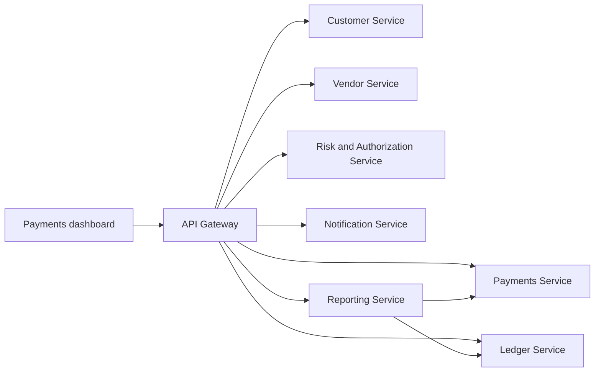

# PayFlow service dependency graph

Each service is a separate FastAPI process/container with its own HTTP API. The gateway exposes the browser-facing API and coordinates a payment flow across domain services. In the code graph below, arrows point from a caller to a called service, so following outward edges models the downstream runtime impact of a caller change.

## Service ownership

| Service | Owns | Depends on |
|---|---|---|
| API Gateway | Public `/api/*` routes, request coordination, static frontend | Customers, Vendors, Risk, Payments, Ledger, Notifications, Reporting |
| Customer Service | Customer identity and contact validation | None |
| Vendor Service | Supported vendor directory and lookup | None |
| Risk and Authorization Service | Mock authorization decisions and decline codes | Vendor Service |
| Payments Service | Payment lifecycle and card metadata (brand, expiry, last four) | None |
| Ledger Service | Append-only simulated charge, capture, and refund entries | Payments |
| Notification Service | Simulated payment event delivery records | Customer Service |
| Reporting Service | Dashboard aggregates | Payments, Ledger, Notifications |

The executable adjacency map lives in `app/dependency_graph.py` and is exposed at `/api/dependencies`. Tests under `tests/services/` import and exercise their owning service. `tests/test_dependency_graph.py` captures the expected traversal: a leaf such as `vendors` or `risk` selects its own service tests, while a caller such as `gateway` or `reporting` selects its own tests plus all tests in services reachable through outgoing edges.

## Payment creation sequence

1. Gateway validates the request shape and asks Customer Service to verify the customer.
2. Gateway resolves the vendor, then requests an authorization decision from Risk Service.
3. Gateway asks Payments Service to create the payment using those decisions.
4. Gateway records the lifecycle event in Ledger Service and Notification Service.
5. Risk Service verifies the vendor with Vendor Service; Ledger Service verifies payment records with Payments Service; Notification Service verifies recipients with Customer Service.
6. Reporting Service combines Payments, Ledger, and Notification data to produce dashboard totals.

## Test selection examples

- A change to `app/services/vendors/` or `app/services/payments/` has no outgoing calls in the caller-to-dependency graph, so run that service's unit tests only.
- A change to `app/services/reporting/` reaches Payments, Ledger, Notifications, and Customers; run Reporting tests plus those downstream service tests.
- A change to `app/main.py` (gateway) reaches every domain service; run gateway integration tests and all tests for the reachable services.

The traversal assertions are in `tests/test_dependency_graph.py`. Service unit tests live under `tests/services/` and import the service modules they cover, giving the indexer concrete Python import relationships as well as the explicit runtime graph.

Card number and CVC are passed only to the mock risk/payment request path and are excluded from stored payment records. This is a local demo architecture: data stores are in-memory and reset when each service restarts.
