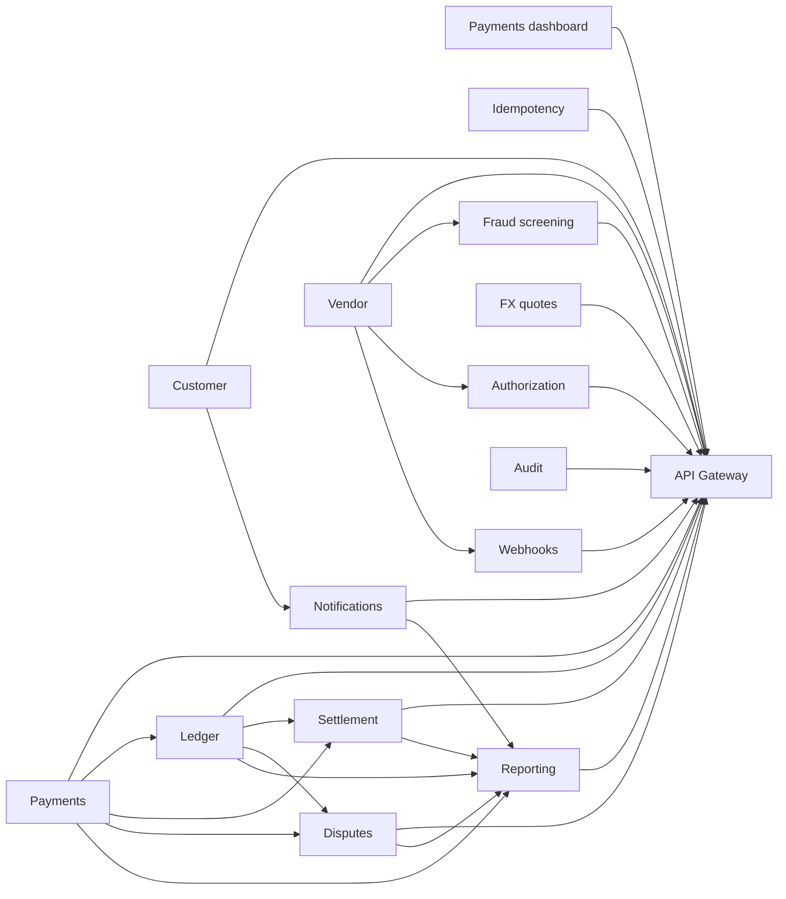

# PayFlow service dependency graph

PayFlow models a multi-service enterprise payments workflow. Each service runs as a separate FastAPI process/container. Edges point from a dependency to services that consume it; traversing outward from a changed service identifies downstream consumers and tests.

## Service ownership and test path

| Service | Responsibility | Direct dependencies | Focused tests |
|---|---|---|---|
| API Gateway | Public API, workflow orchestration, browser frontend | All domain services | `tests/test_gateway.py` |
| Customers | Customer identity and contact validation | None | `tests/services/test_customers.py` |
| Vendors | Merchant directory and lookup | None | `tests/services/test_vendors.py` |
| FX | Currency quote and settlement conversion | None | `tests/services/test_fx.py` |
| Fraud | Transaction scoring and review flags | Vendors | `tests/services/test_fraud.py` |
| Risk | Authorization and decline decision | Vendors | `tests/services/test_risk.py` |
| Idempotency | Duplicate request protection | None | `tests/services/test_idempotency.py` |
| Payments | Payment lifecycle, card metadata, capture/refund state | None | `tests/services/test_payments.py` |
| Ledger | Charge, capture, and refund entries | Payments | `tests/services/test_ledger.py` |
| Settlement | Vendor payout queue | Payments, Ledger | `tests/services/test_settlement.py` |
| Disputes | Chargeback case intake and status | Payments, Ledger | `tests/services/test_disputes.py` |
| Notifications | Customer lifecycle notices | Customers | `tests/services/test_notifications.py` |
| Webhooks | Merchant event delivery queue | Vendors | `tests/services/test_webhooks.py` |
| Audit | Actor and payment-operation history | None | `tests/services/test_audit.py` |
| Reporting | Operational dashboard metrics | Payments, Ledger, Notifications, Settlement, Disputes | `tests/services/test_reporting.py` |

The executable service graph is `app/dependency_graph.py`, exposed by the gateway at `/api/dependencies`. It is oriented dependency-to-consumer to match impact traversal: changing a provider fans out to its consumers; the Gateway is a leaf and its change stays in the Gateway test module. Unit tests stay with each service. `tests/test_gateway.py` exercises the cross-service payment workflow, and `tests/test_dependency_graph.py` checks graph traversal behavior.

## Payment lifecycle

1. Gateway reserves an idempotency key and verifies the customer and vendor.
2. FX quotes the settlement amount; Fraud scores the transaction and Authorization applies a mock approve/decline decision.
3. Payments creates the record. PAN and CVC are never persisted; only brand, expiry, and last four digits are retained.
4. Ledger records the charge. Settlement verifies both the payment and ledger entry before queuing the vendor payout.
5. Notifications verifies the customer; Webhooks verifies the vendor; Audit records the operation.
6. Reporting combines payment, ledger, notification, settlement, and dispute data.
7. A dispute request verifies the payment and ledger evidence before creating a case; Audit and Webhooks record the event.

## Impact-selection examples and timing comparison

- A Gateway-only change has no outward dependent nodes, so run `tests/test_gateway.py` and graph tests.
- A Vendor change fans out to Fraud, Risk, Webhooks, and Gateway. A Payments change fans out to Ledger, Settlement, Disputes, Reporting, and Gateway.
- A leaf operation such as FX affects its own service and Gateway. Broad changes in shared providers select more downstream service suites.

Run the local comparison from this directory with `python scripts/compare_test_runs.py --changed-service gateway` or `--changed-service vendors`. It reports full-suite and graph-selected test counts and elapsed times on your machine. It demonstrates the cost difference; the production PR Impact Agent selector will replace this small local graph runner when integrated. Timing varies by machine and cache state.

All service data is seeded/in-memory and resets on restart. The demo models service boundaries and dependency-driven test selection; it is not a production payment platform.
